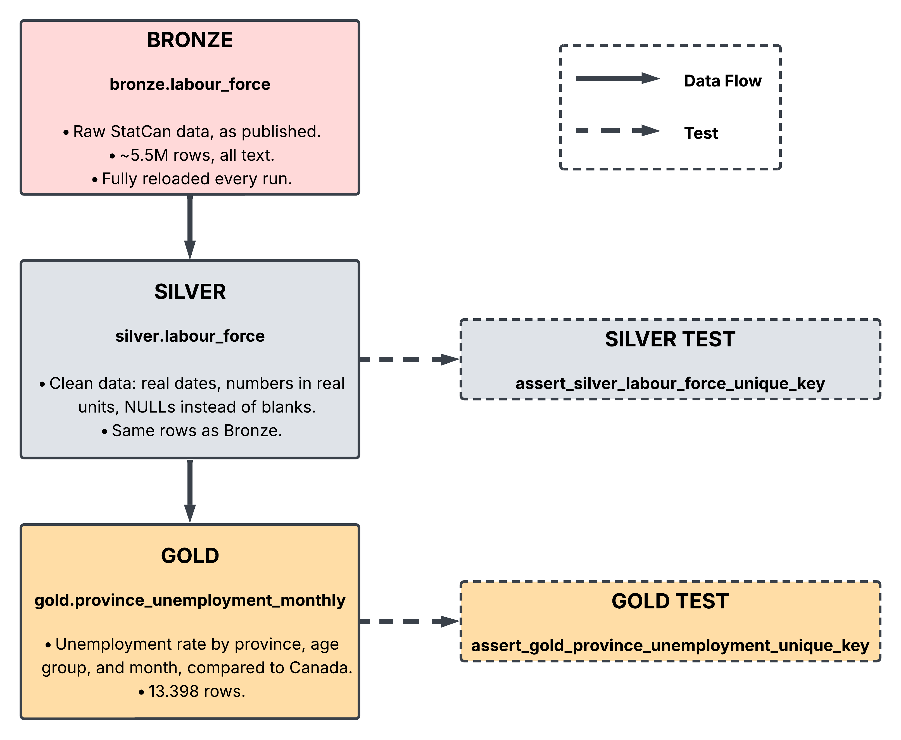

# Canada Labour Pipeline

A data pipeline that pulls Canada's monthly Labour Force Survey from Statistics Canada, cleans it up, and turns it into unemployment numbers by province that are easy to compare.

## Why I built this

I'm a Data Science and Machine Learning student at RRC Polytech in Winnipeg, moving into data engineering. I wanted a project that works like a real pipeline: real data, real tools, scheduled runs, tests and docs. Not just a notebook.

I also wanted it to answer a question people actually have. If you live in Canada, or you're planning to move here, which province gives you the best shot at finding work?

## What it answers

The final table tracks the unemployment rate for every province, every month since 1976, and compares each one to the national rate.

For example, in September 2026:

| Province | Unemployment rate | vs. Canada |
|---|---|---|
| Manitoba | 5.0% | -1.5 pp |
| Saskatchewan | 5.4% | -1.1 pp |
| Canada | 6.5% | 0.0 pp |
| Ontario | 7.0% | +0.5 pp |
| Newfoundland and Labrador | 9.1% | +2.6 pp |

*(Seasonally adjusted, 15 years and over. pp = percentage points.)*

## How it works



Every month, Airflow runs three steps:

1. **Download.** Ask the StatCan API for the latest version of table [14100287](https://www150.statcan.gc.ca/t1/tbl1/en/tv.action?pid=1410028701) and download the ZIP (about 60 MB, 1.2 GB unzipped).
2. **Load.** Stream the CSV from inside the ZIP straight into Postgres. This is the **Bronze** layer: the data exactly as StatCan publishes it, about 5.5 million rows.
3. **Transform.** dbt builds the **Silver** layer (clean, typed, correctly scaled) and the **Gold** layer (the unemployment table above), then runs the tests.

## The layers

- **Bronze** (`bronze.labour_force`): raw data, every column stored as text. Nothing is filtered or changed.
- **Silver** (`silver.labour_force`): same rows as Bronze, but cleaned. Dates are real dates, values are numbers in real units (StatCan publishes people counts in thousands), empty values are `NULL`, and useless columns are dropped.
- **Gold** (`gold.province_unemployment_monthly`): one row per province, age group and month.

| Column | What it means |
|---|---|
| `unemployment_rate` | The rate for that month, in percent |
| `mom_change_pp` | Change from the previous month |
| `yoy_change_pp` | Change from the same month last year |
| `canada_unemployment_rate` | The national rate for the same month |
| `gap_vs_canada_pp` | Province minus Canada. Negative means better than the national rate |

Gold has two age groups: **15 years and over**, the official rate you see in the news, and **25 to 54 years**, the core working age, which is closer to the reality of someone moving here to work.

## Tech-Stack

- **Python** downloads the data and loads it into Postgres
- **PostgreSQL** stores all three layers
- **dbt** handles the transformations, tests and documentation
- **Airflow** runs everything on a schedule, in order, with retries
- **Docker** runs Postgres and Airflow, so the whole thing starts with one command
- **uv** manages the Python dependencies

## Design decisions

**Full refresh instead of incremental loads.** StatCan republishes the whole history every month, and older months get revised (seasonal adjustments are recalculated every year). Only appending the new month would keep outdated numbers around. Reloading all 5.5M rows takes about 10 seconds, so the simple option is also the correct one.

**The load is all or nothing.** Emptying the table and loading the new data happen in a single transaction. If anything fails halfway, Postgres rolls back and the previous data is still there. Bronze is never left empty.

**Silver cleans, Gold decides.** Silver keeps every row and only fixes types, units and empty values. Business choices, like using only seasonally adjusted estimates, live in Gold. That way, a new Gold model can make different choices without touching Silver.

**Scale only what needs scaling.** People counts come in thousands and get multiplied by 1000. Rates are already percentages and stay as they are. The `unit` column changes along with the value, so it never says "thousands" when the number isn't in thousands anymore.

**Fail loudly.** The scripts don't catch errors just to print them. If something breaks, the task fails, Airflow marks it red and retries it. A failure you can see beats a pipeline that quietly loads old data.

**Run on the 8th of each month.** StatCan publishes on the first Friday of the month, which always falls between the 1st and the 7th. Cron can't really express "first Friday", so the 8th is the simplest date that's always after the release.

**dbt gets its own Python environment.** dbt and Airflow need different versions of some of the same libraries. Inside the Docker image, dbt lives in a separate virtualenv and Airflow calls it as a command.

**Same code locally and in Docker.** The scripts and dbt read the database host and port from environment variables. On my machine they point to `localhost:5433`, inside Docker to `postgres:5432`. Nothing in the code changes.

## Run it yourself

You'll need Docker (with Docker Compose) and Git.

**1. Clone the repo**

```bash
git clone https://github.com/renatoblandi/canada-labour-pipeline.git
cd canada-labour-pipeline
```

**2. Create your `.env`**

```bash
cp .env.example .env
```

Then open `.env` and fill in:

- the two passwords (`POSTGRES_PASSWORD` and `AIRFLOW_DB_PASSWORD`)
- `AIRFLOW_UID`: your user ID, which you get with `id -u`
- `AIRFLOW_JWT_SECRET`: a long random value, which you can generate with:

```bash
python3 -c "import secrets; print(secrets.token_urlsafe(64))"
```

**3. Create the folders Airflow writes to**

```bash
mkdir -p airflow-logs data
```

This step matters. If these folders don't exist, Docker creates them owned by root, and Airflow can't write to them.

**4. Build the Airflow image and start everything**

```bash
docker build -t lfs-airflow docker/
docker compose up -d
```

**5. Run the pipeline**

Open [http://localhost:8080](http://localhost:8080), turn on the `lfs_pipeline` DAG and hit the trigger button. A full run takes about a minute.

**6. Look at the results**

```bash
docker compose exec postgres psql -U lfs -d lfs
```

```sql
SELECT geo, unemployment_rate, gap_vs_canada_pp
FROM gold.province_unemployment_monthly
WHERE age_group = '15 years and over'
  AND ref_date = (SELECT max(ref_date) FROM gold.province_unemployment_monthly)
ORDER BY unemployment_rate;
```

(Use the user and database names from your `.env` if you changed them.)

### Ports

- Postgres is on **5433** on your machine, so it doesn't clash with a local Postgres on 5432.
- Airflow is on **8080**.

### If the Airflow page shows an error about `toUpperCase`

That's a leftover setting in your browser, usually from another app that ran on `localhost:8080` before (like `dbt docs serve`). Open the browser console (F12) and run `localStorage.removeItem("timezone")`, then reload.

## Running the pieces locally

If you have [uv](https://docs.astral.sh/uv/), you can run each step outside Airflow, against the Postgres container:

```bash
uv sync
uv run python extraction/download.py
uv run python extraction/load.py
```

dbt doesn't read `.env` on its own, so pass it in:

```bash
cd dbt
uv run --env-file ../.env dbt build
uv run --env-file ../.env dbt docs generate
uv run --env-file ../.env dbt docs serve --port 8081
```

The docs site has a description for every table and column, plus the full lineage graph.
